# Proyecto 1: Librería Tinta

## Descripción del proyecto

Este proyecto consiste en desplegar una página web para la Librería Tinta utilizando los servicios de Amazon Web Services (AWS).

Se ha configurado una red virtual (VPC) con una subred pública, acceso a Internet y las reglas de seguridad necesarias para alojar los servidores web. Además, se ha utilizado Amazon Route 53 para configurar un DNS privado y AWS CLI para automatizar el despliegue de una instancia.

## 1. Diagrama de arquitectura

El siguiente diagrama muestra la infraestructura desplegada en AWS, incluyendo la VPC, la subred pública, el Internet Gateway, la tabla de rutas, los grupos de seguridad, las instancias EC2 y la configuración de Route 53.


## 2. Configuración de la infraestructura AWS

### B1. Creación de la red

Para desplegar la web de Librería Tinta, se ha creado una VPC llamada `libreria-vpc`, con el bloque de direcciones `10.0.0.0/16`, en la región `us-east-1`.

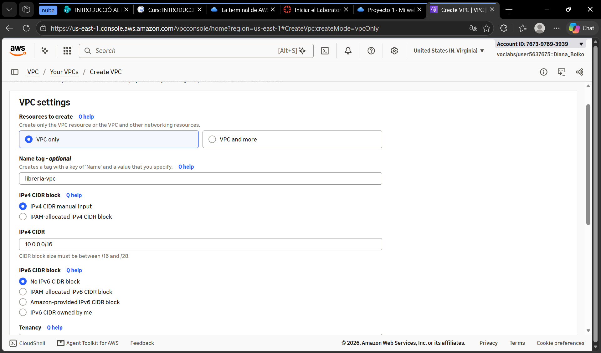

Dentro de esta VPC se ha configurado una subred pública llamada `libreria-publica`, con el rango `10.0.1.0/24`. Se ha habilitado la asignación automática de direcciones IPv4 públicas para que las instancias puedan ser accesibles desde Internet.

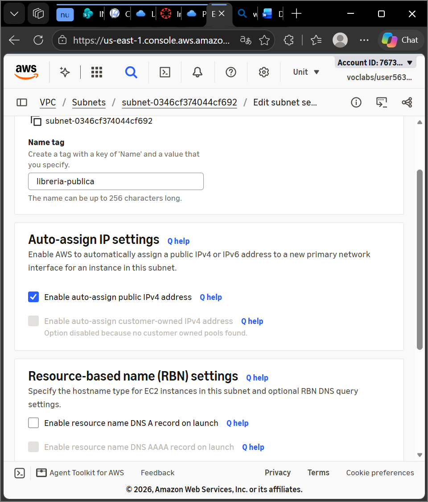

También se ha creado un Internet Gateway llamado `libreria-igw` y se ha asociado a la VPC para permitir la comunicación con Internet.

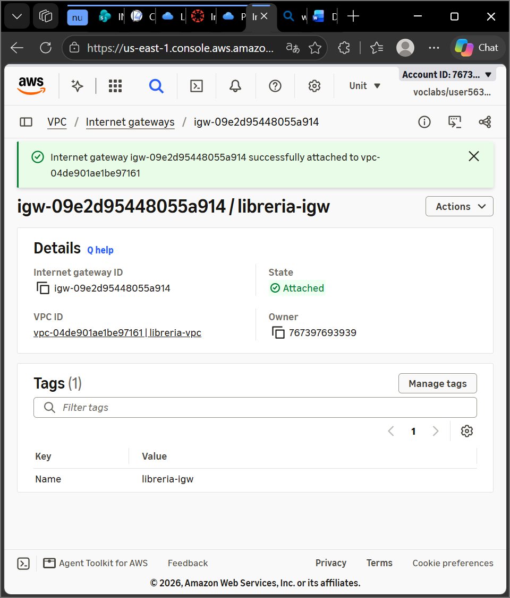

Por último, se ha configurado una tabla de rutas llamada `libreria-rt-publica`, asociada a la subred pública.

Esta tabla contiene una ruta local (`10.0.0.0/16`) para la comunicación dentro de la VPC y una ruta (`0.0.0.0/0`) hacia el Internet Gateway para permitir el acceso a Internet.

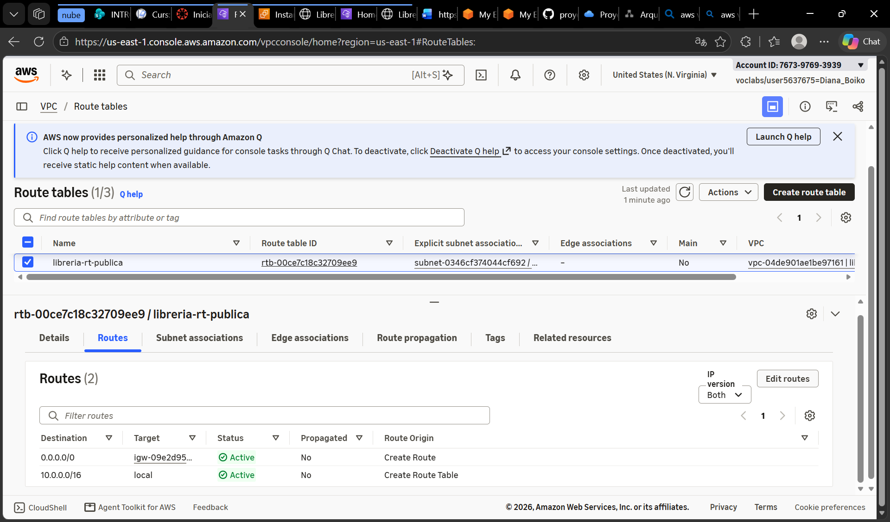

### B2. Configuración de seguridad

Se ha creado un grupo de seguridad llamado `libreria-web-sg`, asociado a la VPC, para controlar el tráfico de entrada a las instancias.

Se han configurado las siguientes reglas:

- **HTTP (puerto 80):** acceso permitido desde cualquier dirección IP (`0.0.0.0/0`).
- **SSH (puerto 22):** acceso restringido a mi dirección IP pública.

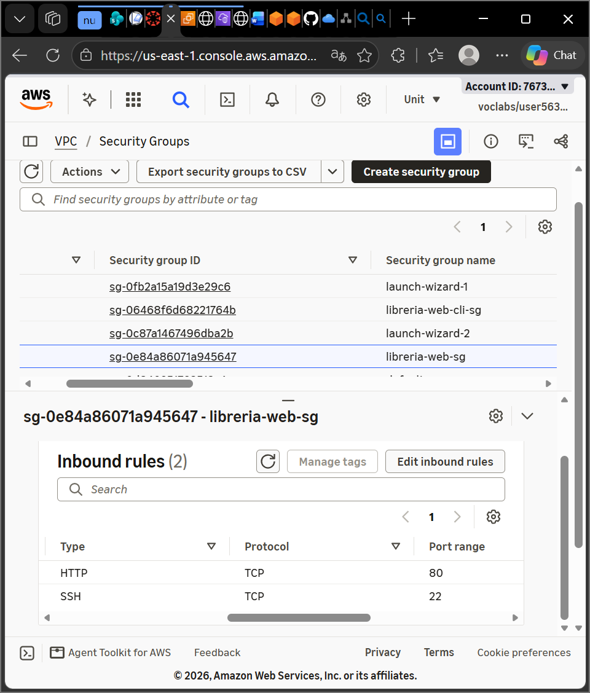

### B3. Despliegue del servidor web

Se ha lanzado una instancia EC2 llamada `libreria-web`, utilizando Amazon Linux 2023 y el tipo de instancia `t3.micro`.

Mediante un script de inicio (`user-data1.sh`), se ha instalado y configurado Nginx para mostrar la página web de Librería Tinta.

También se ha desplegado una segunda instancia, `libreria-web2`, con Apache y una versión diferente de la página. Esta segunda instancia se utiliza en la configuración DNS del nivel medio.

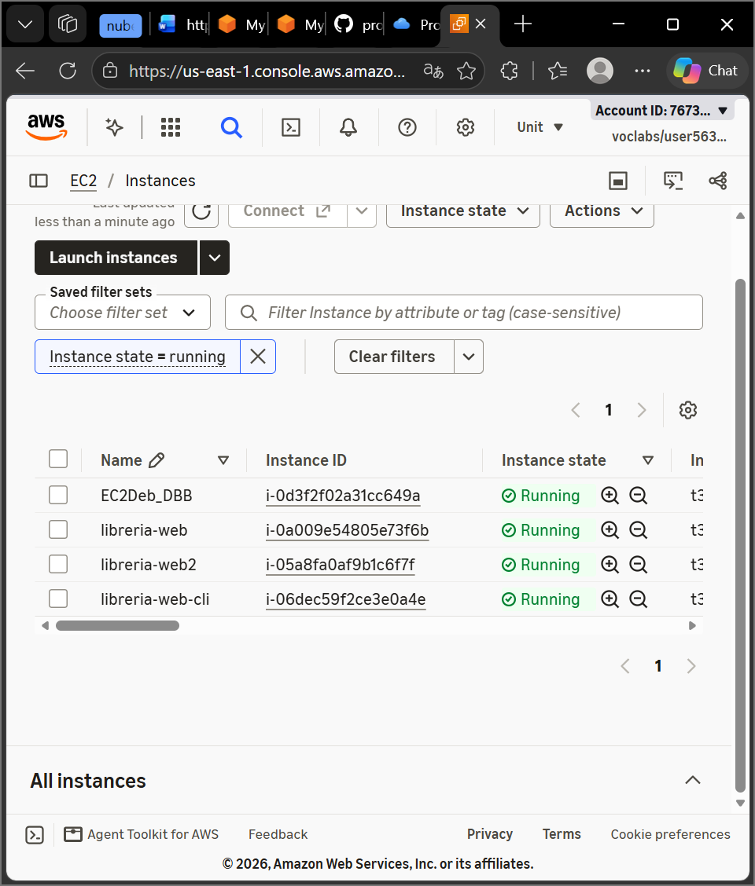

Se ha comprobado que ambas páginas funcionan correctamente accediendo desde el navegador mediante sus direcciones IP públicas.

**Servidor 1:**

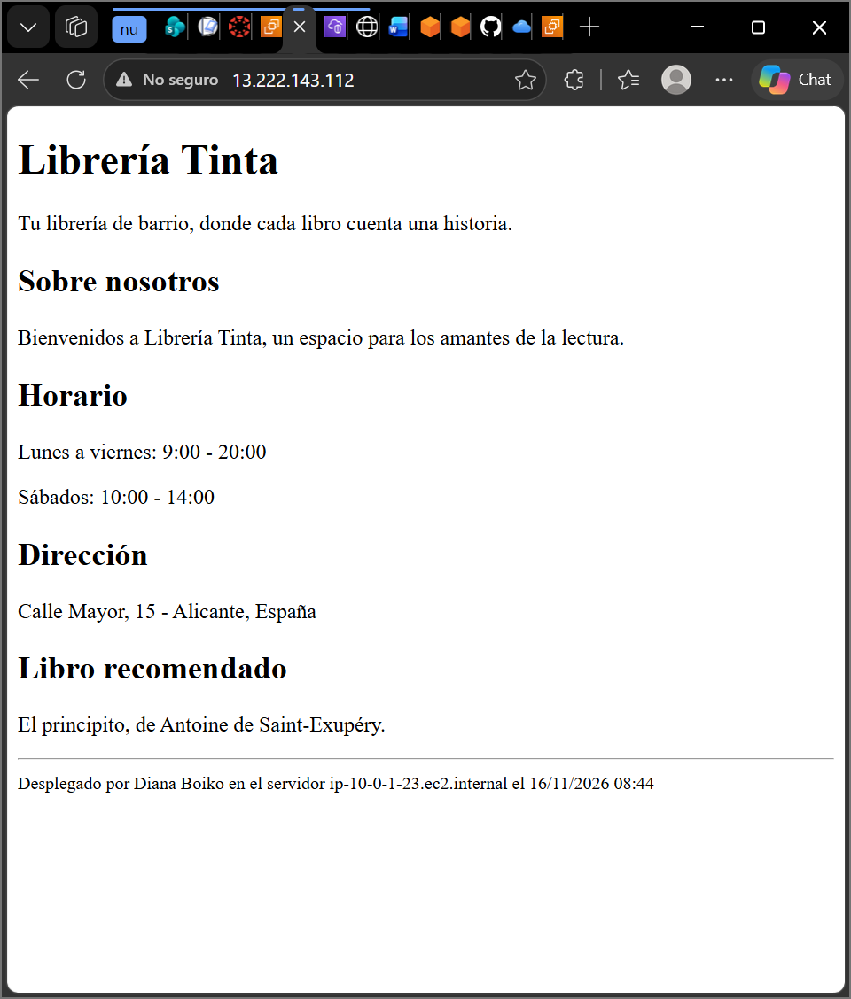

**Servidor 2:**

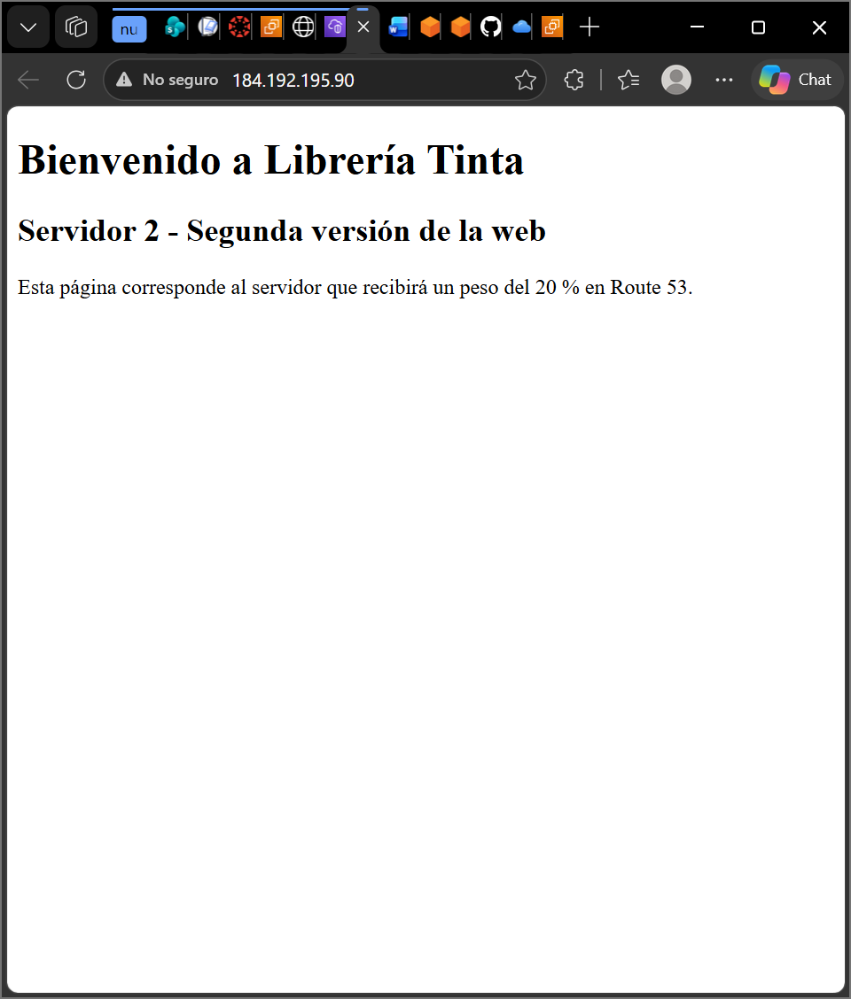

## 3. Justificación de la configuración de red y seguridad

La subred `libreria-publica` es pública porque tiene asociada una tabla de rutas con una salida hacia Internet (`0.0.0.0/0`) a través del Internet Gateway. Además, las instancias pueden recibir direcciones IP públicas.

El acceso SSH se ha limitado a mi dirección IP para evitar conexiones de administración desde otros equipos. En cambio, el puerto HTTP está abierto a cualquier origen porque es necesario para acceder a la página web.

## 4. Presupuesto del servicio

Para estimar el coste de la infraestructura se ha utilizado AWS Pricing Calculator.

Inicialmente, se calculó el coste del despliegue básico con una instancia EC2 `t3.micro`, obteniendo un presupuesto de **11,88 USD mensuales** y **142,56 USD anuales**.

Posteriormente, se actualizó la estimación para incluir dos servidores EC2 y Amazon Route 53.

El presupuesto final obtenido fue el siguiente:

| Servicio | Coste mensual |
|---|---:|
| Amazon EC2 | 24,70 USD |
| Amazon VPC | 3,65 USD |
| Amazon Route 53 | 0,50 USD |
| **Total mensual** | **28,85 USD** |

El coste anual estimado es de **346,20 USD**, sin costes iniciales.

Esta comparación permite observar cómo aumenta el presupuesto al incorporar nuevos recursos. Los importes son orientativos y pueden variar según el uso real de los servicios.

## 5. Nivel medio: configuración de DNS con Route 53

Para el nivel medio se ha utilizado Amazon Route 53, creando una zona hospedada privada llamada `libreria.lab`, asociada a la VPC `libreria-vpc`.

Dentro de esta zona se han configurado dos registros de tipo A con el mismo nombre, `web.libreria.lab`, utilizando una política de enrutamiento ponderado:

- **Servidor 1:** dirección privada `10.0.1.132`, con un peso de 80.
- **Servidor 2:** dirección privada `10.0.1.105`, con un peso de 20.

Ambos registros tienen un TTL de 60 segundos.

Esta configuración permite repartir las respuestas DNS entre los dos servidores según los pesos establecidos.

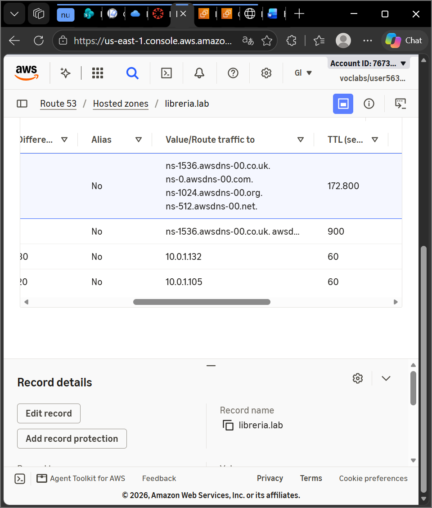

### Comprobación del DNS

Para comprobar el funcionamiento, se ha accedido mediante SSH a una de las instancias EC2 y se ha ejecutado el siguiente comando:

```bash
nslookup web.libreria.lab
```

El resultado muestra que el nombre `web.libreria.lab` se resuelve correctamente a una dirección IP privada de la VPC.

También se ha utilizado `curl` para comprobar que el servidor responde a las peticiones HTTP realizadas mediante el nombre DNS.

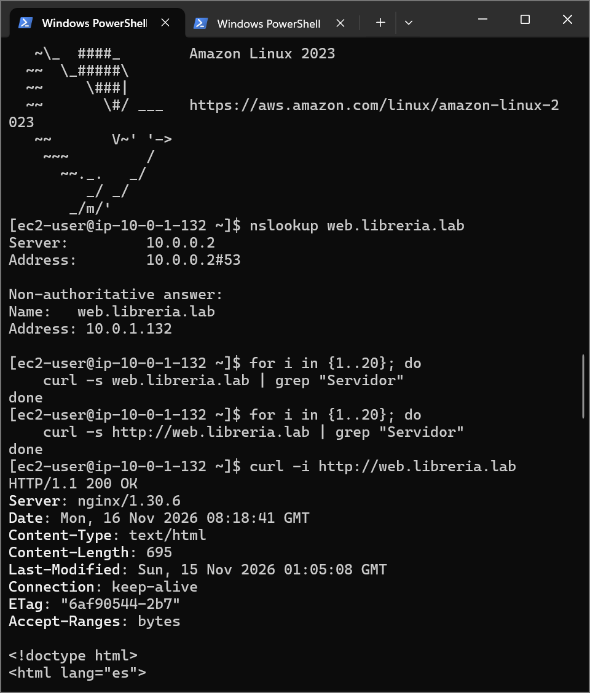

## 6. Nivel avanzado: despliegue mediante AWS CLI

En el nivel avanzado se ha automatizado el despliegue de un servidor web mediante un script Bash llamado `desplegar.sh`.

El script reutiliza la VPC y la subred creadas anteriormente y realiza las siguientes operaciones:

1. Obtiene la AMI más reciente de Amazon Linux 2023.
2. Crea un nuevo grupo de seguridad llamado `libreria-web-cli-sg`.
3. Configura el acceso HTTP desde cualquier origen y el acceso SSH únicamente desde mi IP.
4. Lanza una instancia EC2 `t3.micro` utilizando el archivo `user-data1.sh`.
5. Espera a que la instancia esté en ejecución.
6. Obtiene su dirección IP pública y muestra la dirección para acceder a la web.

Los archivos utilizados están incluidos en este repositorio:

- `desplegar.sh`
- `user-data1.sh`
- `user-data2.sh`

### Comprobación del funcionamiento

El script se ha ejecutado desde AWS CloudShell y ha finalizado mostrando el identificador de la instancia creada y su dirección IP pública.

La instancia desplegada se llama `libreria-web-cli` y se ha comprobado que la página de Librería Tinta funciona correctamente desde el navegador.

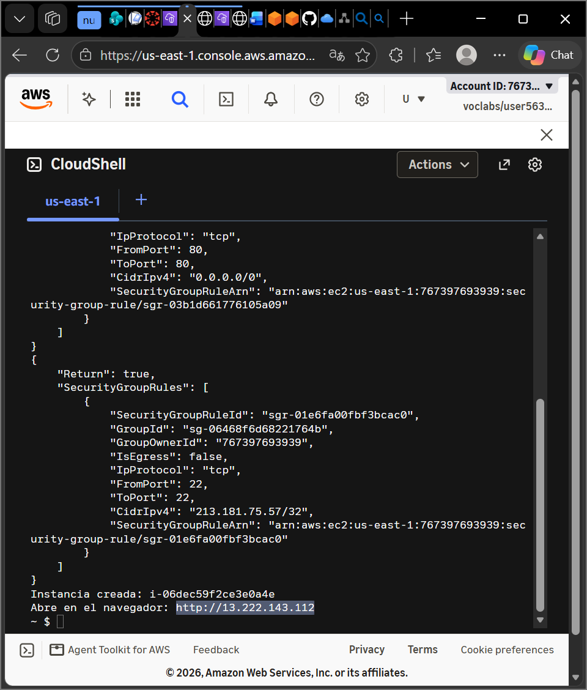

## 7. Uso de IA

Durante la realización del proyecto se ha utilizado ChatGPT como herramienta de apoyo para comprender algunos conceptos de AWS y resolver dudas durante la configuración de los servicios.

También se ha utilizado para revisar comandos de AWS CLI, completar el script de despliegue y organizar la documentación del repositorio.

La configuración de los recursos, la ejecución de los comandos y las comprobaciones del funcionamiento se han realizado en el entorno de AWS Academy.
