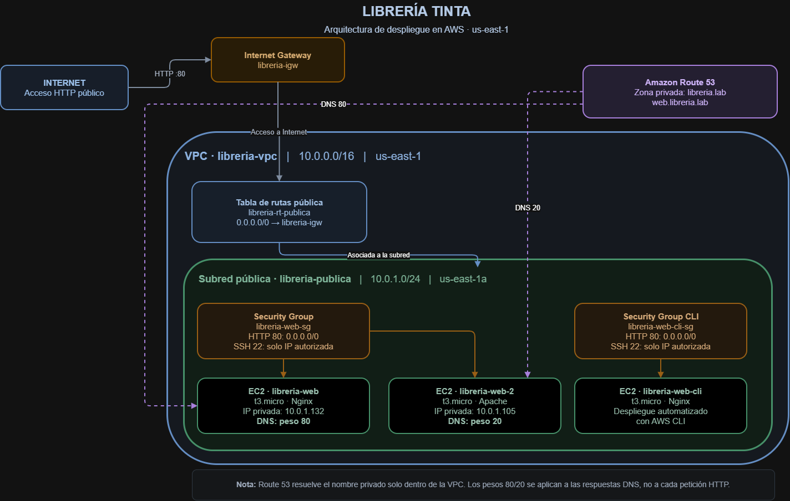

# Proyecto 1: Librería Tinta

## Descripción del proyecto

Este proyecto consiste en desplegar una página web para la Librería Tinta utilizando los servicios de Amazon Web Services (AWS).

Se ha configurado una red virtual (VPC) con una subred pública, acceso a Internet y las reglas de seguridad necesarias para alojar los servidores web. Además, se ha utilizado Amazon Route 53 para configurar un DNS privado y AWS CLI para automatizar el despliegue de una instancia.

## 1. Diagrama de arquitectura

El siguiente diagrama muestra la infraestructura desplegada en AWS, incluyendo la VPC, la subred pública, el Internet Gateway, la tabla de rutas, los grupos de seguridad, las instancias EC2 y la configuración de Route 53.

